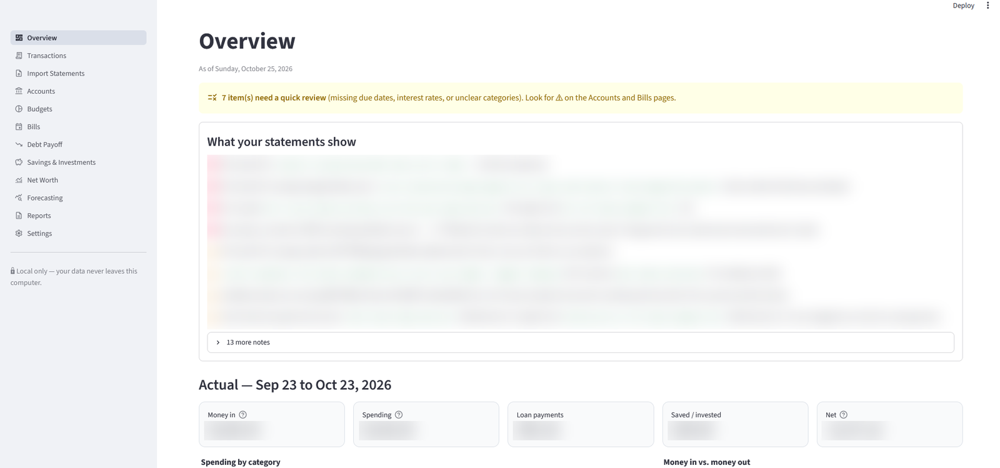
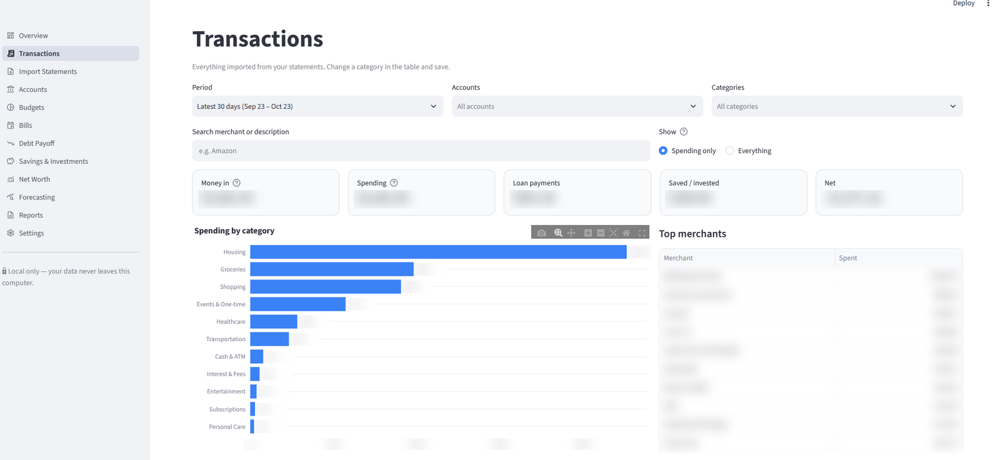

# Personal Finance (local)

A private, local personal-finance app — accounts, bills, debts, net worth and (in later stages) transactions,
budgets, forecasting and Excel reports. Runs in your browser at `http://localhost:8501`; all data stays in a
SQLite file on this computer. No accounts, no cloud, no subscriptions, no bank logins.

**Status: Stage 1 of 5** (see [Roadmap](#roadmap)).

---

## Screenshots

*Personal figures, merchants and statement notes are blurred.*

**Overview:** plain-language findings from imported statements, plus monthly actuals


**Transactions:** filters, spending by category and top merchants


## Setup on Windows (one time)

1. Install **Python 3.12 or 3.13** from <https://www.python.org/downloads/>.
   On the first installer screen tick **"Add python.exe to PATH"**.
2. Double-click **`run_app.bat`**.
   The first run creates a private virtual environment (`.venv`) and installs the packages in
   `requirements.txt` (a few minutes, needs internet once). After that the app works offline.
3. Your browser opens to the app. Close the black console window to stop it.

Next time, just double-click `run_app.bat`.

### Bring in your existing spreadsheet
On first launch the Overview page finds any budget workbook (`.xlsx`) in the folder **above** the app folder
and offers a one-click **Import** button. You can also use **Import Statements → Budget workbook** at any time,
or the command line:

```bat
.venv\Scripts\python scripts\import_workbook.py "C:\path\to\Finances.xlsx"
```

Re-importing an updated copy updates amounts, adds new balance-history points and never deletes anything.
Items the importer couldn't classify confidently are imported with a ⚠ **Review** flag (Accounts and Bills pages).

### Try it with fictional data
`run_app.bat demo` opens a separate demo database (`demo_data\demo.db`) filled with example data.
Your real database is untouched.

### Financial Snapshot from your statements
Drop statements into `Finance\Statements`, then run:

```bat
.venv\Scripts\python scripts\statement_report.py "..\Statements" --workbook "..\Finances(1).xlsx" --expect "Citi,Apple Card,American Express,Ally Bank,PA Central FCU,Nelnet,Fidelity"
```

It writes `Finance\Reports\Financial Snapshot.html` (opens offline; nothing uploaded) and
`Categorized transactions.csv`. Every statement is reconciled against its own totals before it's used.
Parsers so far: PA Central FCU (PDF), Nelnet (PDF), HealthEquity HSA (PDF), Fidelity net-worth CSV.
Files from other institutions are listed as "skipped" until a parser is added.

---

## Where your data lives

| What | Location |
| --- | --- |
| Database | `%LOCALAPPDATA%\PersonalFinanceApp\finance.db` |
| Backups | `%LOCALAPPDATA%\PersonalFinanceApp\backups\` |

The default is deliberately **outside OneDrive/Desktop** so the database isn't uploaded to the cloud.
Override with environment variables if you want: `FINANCE_APP_DATA_DIR` (a folder) or `FINANCE_APP_DB`
(a full file path). Settings shows the active path and warns if it's in a synced folder.

**Backups:** Settings → *Create backup now* or *Download a backup copy*. A backup is also made automatically
before any database upgrade. To restore, close the app and copy a backup file over `finance.db`.

---

## Using Stage 1

| Page | What works now |
| --- | --- |
| **Overview** | Monthly income, expenses, cash flow, savings rate; cash, available-after-bills, savings & investments, debt, net worth; charts (income vs outflows, spending by category, debt by account, net worth trend); upcoming bills |
| **Accounts** | Add/edit/deactivate/delete accounts (checking, savings, HYSA, retirement, brokerage, cash, money owed to you, other assets, credit cards, loans); update balances with full history and chart; credit utilization |
| **Bills** | Recurring items: fixed bills, planned variable spending, debt payments, savings contributions. Monthly/weekly/biweekly/twice-monthly/quarterly/annual; due in 7/14/30 days; overdue; mark paid/skipped and undo; income sources |
| **Debt Payoff** | Current debts, APR, minimums, utilization, what's missing for payoff planning |
| **Net Worth** | Assets vs liabilities by type and history |
| **Import Statements** | Budget-workbook import with preview and import history |
| **Settings** | Data location, backups, categories, audit history, theme tip |

How the numbers are defined:
- **Monthly expenses** = fixed bills + planned variable spending + debt payments (monthly equivalents).
  Savings/investment contributions are *not* expenses.
- **Monthly cash flow** = income − expenses. **Savings rate** = cash flow ÷ income.
- **Available after bills** = checking + savings + cash − unpaid bills/debt payments due in the next 30 days.
- **Net worth** = assets − liabilities (accounts with *Include in net worth* ticked).
- A bill is **never** treated as paid because its due date passed — only when you mark it (or, from Stage 3,
  confirm a matching transaction). Cycles before a bill was added aren't flagged overdue.
- Liability balances are entered as the positive amount owed. Balances are what you entered/imported, not live
  lender figures.

Light/dark theme: menu **⋮** (top right) → **Settings** → **Theme**.

---

## Tests

Double-click `run_tests.bat`, or:

```bat
.venv\Scripts\python -m pytest -q
```

Covers money parsing, schedule/due-date math (month ends, leap years, all frequencies), metrics and net-worth
history, account validation & audit log, bill status/paid logic, the workbook importer (including re-imports),
persistence across restarts, rollback on errors, backups, and renders every page with Streamlit's AppTest.

---

## Project layout

```
app.py                     Streamlit entry point + sidebar navigation
run_app.bat / setup.bat    Windows launcher and one-time setup
finance/
  config.py                data location
  db/                      SQLAlchemy models, session, migrations
  calculations/            pure math: schedules, metrics (amortization in Stage 4)
  categorization/          classification rules
  importers/               budget workbook (bank statements in Stage 2)
  services/                accounts, bills, income, dashboard, audit, backup, categories
  reporting/               Excel/CSV export (Stage 5)
  ui/                      shared helpers and one module per page
  utils/                   money helpers
scripts/                   init_db, import_workbook, load_example_data
tests/                     pytest suite
```

Money is stored as integer cents. Schema changes go through `finance/db/migrations.py` (versioned,
idempotent, automatic pre-upgrade backup).

---

## Roadmap

- **Stage 1 ✅** Project structure, SQLite database, accounts, basic dashboard (+ bills core, workbook import)
- **Stage 2** CSV/Excel statement import, column mapping & bank templates, normalization, categorization rules,
  duplicate & transfer detection, transaction list with filters
- **Stage 3** Full bills calendar & transaction matching, budgets, income tracking vs projected, reconciliation
- **Stage 4** Debt amortization, payoff dates, snowball/avalanche, extra-payment calculator, savings goals,
  investments, net worth
- **Stage 5** Forecasting & scenarios, PDF statement import, Excel/CSV reporting, restore from backup, UI polish
